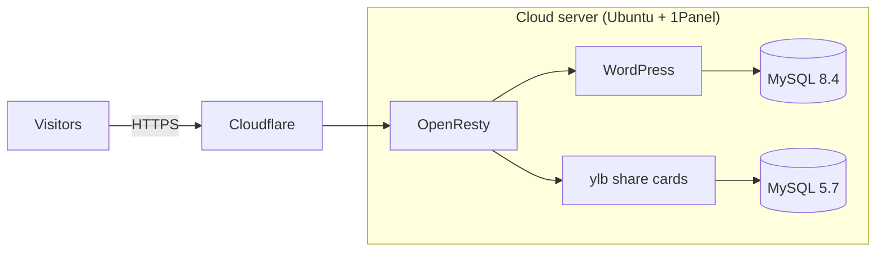
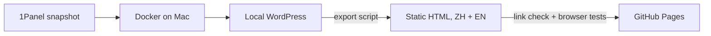

# CCICHA Website Archive

English | [中文](README.zh-CN.md)

The website I built and ran for the **Canada-China Intangible Cultural Heritage Association** (加中非遗文化传承协会), now preserved as a bilingual static site.

**Live demo:** https://otyswkydo.github.io/yunlian-legacy-demo/ ([English version](https://otyswkydo.github.io/yunlian-legacy-demo/en/))

- Online as a self-hosted WordPress site from **Aug 2025 to Aug 2026**
- Recovered from a 7.5 GB server snapshot after the server expired
- Now a free static archive on GitHub Pages: 258 pages in Chinese and English, 24,408 internal links checked, 0 broken

## About the project

The association runs workshops, performances and community events in Toronto. Its programs cover traditional Chinese crafts and arts such as dough sculpture (面塑), *huamo* decorative buns (花馍), Peking Opera and Baduanjin. I think this kind of work is good for cultural diversity here, and it's a nice way for people to get to know Chinese culture.

Before this, I had set up a home NAS and built a few small websites for fun. I wanted to try running a real site from start to finish, with a domain, HTTPS, a database, backups and actual visitors. So I offered to build the association's website.

I want to study Computer Engineering. What I enjoyed most in this project was taking something I pictured in my head and turning it, step by step, into something that actually works. For example, I wanted a static page with no server to behave like a real store: add to cart, change quantities, calculate tax. That meant breaking the idea into parts, trying it, and fixing it until even the edge cases were right. Every problem taught me something I didn't know before, like how a database stores settings, how a browser responds to a click, or where GitHub gets the text next to a folder. I'd write each one down as a lesson. That loop of imagining, building, hitting a problem, understanding why and writing it down is what I want to keep doing in Computer Engineering.

The site has 74 products and courses, 15 event articles, 9 pages and 111 images.

## Phase 1: Running the site (Aug 2025 – Aug 2026)

I wanted something the association could actually depend on, so I focused on stability and security.

- I rented a cloud server running Ubuntu and managed it with [1Panel](https://github.com/1Panel-dev/1Panel), an open-source web panel for Linux servers.
- I put the domain behind [Cloudflare](https://www.cloudflare.com/). Traffic is encrypted, and the server's real IP stays hidden.
- WordPress and MySQL each ran in their own Docker container, so the app and the data stayed separate.
- [OpenResty](https://openresty.org/), an Nginx-based web platform, worked as the reverse proxy, sending each visitor to the right container.
- The site itself is [WordPress](https://wordpress.org/) + [WooCommerce](https://woocommerce.com/) with the [Blocksy](https://creativethemes.com/blocksy/) theme.

Most of the audience shares links on WeChat. WeChat only shows a proper preview card (title, image and summary) for websites it has verified, so our links showed up as plain URLs. I found [私域引流宝 (liKeYun_ylb)](https://github.com/likeyun/liKeYun_ylb), a free, MIT-licensed PHP tool. One of its features is WeChat share cards. I deployed it next to WordPress as its own PHP service with a separate MySQL 5.7 database. After that, links shared in WeChat showed up as cards with a cover image and description.

## Phase 2: Recovering the site from a snapshot

When the server expired in August 2026, I didn't renew it. I kept the full 1Panel snapshot, 7.5 GB. My goal changed from "keep it running" to "archive it": keep the site viewable for free, with no server to look after.

My first plan was to run an Ubuntu virtual machine in VMware on my Mac, reinstall 1Panel, restore the backup there, and export the pages with the [Simply Static](https://simplystatic.com/) plugin. It didn't work well. Rebuilding a whole server in a VM was slow on a MacBook Air, and the free plugin couldn't export everything, because parts of the site need the Pro version.

So I switched to running Docker directly on macOS with [OrbStack](https://orbstack.dev/), and had Claude write scripts to restore the site instead. Some of the problems I ran into:

- **There was no normal database backup**, only MySQL's raw files. The tool I used to read them quietly damaged some of the data (problem 1 below).
- **The snapshot is a backup of the whole server**, not just this site. I worked out which folders and which database belonged to the heritage site from the server's config files, and wrote it down in an inventory document.
- **Lots of small things.** A script broke on the old Bash that ships with macOS (problem 2 below). Docker image downloads kept timing out. GitHub stopped accepting my password for uploads. None of these were hard on their own, but each one took real time. I learned to read the error message properly before trying random fixes.

In the end, one script, `restore-from-1panel.sh`, restores the site from the snapshot. The private repo only holds this project's code and docs. Passwords, keys and database dumps stay out of Git.

## Phase 3: Static, bilingual archive

A static site doesn't need a server or a database, so it's free to host and there's almost nothing left to attack. The catch is that a straight export loses everything interactive. I wanted it to still feel like the real site.

The export script crawls the local site with wget, then fixes up the output: it downloads the files that only load on demand, rewrites links, and removes anything that only works on a server. On top of that, I came up with the following features and had Claude write the code for them:

- **A shopping cart.** For an archive this wasn't strictly needed, since nobody is buying anything anymore. I wanted it mainly as a challenge, to see whether a static page with no backend could still behave like a store. Items are saved in the visitor's browser (`localStorage`). You can add products, change quantities with +/−, preview the cart by hovering over the icon, and see totals with Ontario's 13% HST. The cart, checkout and register pages all work as a demo, and anything that would need a server shows a short notice instead.
- **Sliding product carousels** with animation and touch swipe on phones.
- **A tidier structure.** All articles live under `blog/`, old URLs still lead to the right place, and every folder on GitHub has a one-line description.
- **A full English version.** There's an EN / 中文 button on every page, and the cart is shared between the two languages. The translations (471 entries, about 17,700 Chinese characters) live in one dictionary file. If the content changes, the export lists whatever still needs translating.
- **A responsive header.** The English name is much longer than the Chinese one, so font size and menu spacing scale with the window, and nothing overlaps at any width.

The harder bugs I hit along the way (a crawler that wouldn't stop, broken links, cart buttons that stopped responding) are explained in "Problems I ran into" below.

## How I learned and worked

When I built the site in Phase 1, I had never formally learned about servers or running a website, so I learned as I went. I followed video tutorials and how-to posts online step by step. Whenever I hit an error, I copied the message into a search engine, read how other people had run into it and fixed it, and then went back and tried again. That's how I figured out the cloud server, 1Panel, Docker, the reverse proxy and Cloudflare, one piece at a time.

By Phases 2 and 3 the problems were much more specific, and it was hard to find anyone online with exactly the same situation. So I worked differently: I did these phases together with [Claude](https://claude.ai), an AI assistant, over one long back-and-forth conversation. Claude wrote and debugged most of the scripts and code. My part was deciding what to build, running everything on my own Mac, testing it in the browser, and reporting what was wrong.

Roughly how it went:

1. I explained what I had (a 1Panel snapshot, no server) and what I wanted (the site back, organized in GitHub, nothing private leaked). I made the key choices myself: keep the main repo private, and use OrbStack for Docker.
2. I ran the restore scripts on my Mac and pasted back every error: a wrong path, an `unbound variable` from Bash 3.2, Docker Hub timing out, GitHub rejecting my password. We fixed them one by one.
3. When the free plugin couldn't export the full site, I asked whether there was another way. That's when I had Claude write the custom export script.
4. After the first export, I went through the site like a visitor and kept asking for fixes and features:
   - the cart and register pages should work as demos;
   - the search popup's ✕ wouldn't close;
   - I wanted the hover cart preview, real add-to-cart, automatic totals without the "Update cart" button, and animated product sliding.
5. I asked for the GitHub side to look clean too: commits under my username, articles grouped into one folder, and a description next to each folder.
6. Then I asked for the full English version, and later for the header to scale properly and for the leftover demo link to be fixed.

Doing it this way taught me a lot. I didn't just paste the fixes. I kept asking why each problem happened until I could explain it myself. I also learned to describe a bug precisely: what I clicked, what I expected, and what actually happened. That turned out to be most of the work.

## Problems I ran into

### 1. The database looked fine, but some of the data was quietly broken (Phase 2)

**What went wrong.** The server backup didn't include a normal database export. It only had MySQL's raw storage files. I used a tool called ibd2sql to turn those files back into a database. It imported with no errors and the site opened, so at first I thought it had worked.

**What I found.** When I checked the data row by row, some text had changed. A special space character (the kind that keeps two words on the same line) had turned into the letters `xa0`. Some of WordPress's saved settings couldn't be loaded at all.

The reason: the tool wrote text using Python's rules for special characters, but MySQL reads them with different rules. So `\xa0` meant "special space" to Python, but MySQL just saw the letters `x`, `a`, `0`.

That broke the settings because WordPress saves many of them with the length written in front, like `s:5:"hello"` ("a 5-character piece of text: hello"). If one character turns into three, the label still says 5 but the text is longer, and WordPress refuses to read it.

**What changed.** I had Claude change the tool to use MySQL's rules and exported again. Before, some settings couldn't be loaded and some text had stray `xa0`s in it. After, every table has exactly the same number of rows as the original files, and all **661** saved settings load correctly.

**Takeaway.** "No error message" doesn't mean "the data is right". You have to check the results yourself.

### 2. One Chinese bracket stopped the whole script (Phase 2)

**What went wrong.** When I ran the restore script on my Mac, it stopped right away with `db?: unbound variable`, which means "there's no variable called `db?`". But I never made anything called `db?`.

**What I found.** One line looked like `$db（`. That's a variable called `db` with a Chinese full-width bracket right after it. Macs come with a very old version of Bash, the program that runs the script, from 2007. That version took part of the Chinese bracket as part of the name, so it went looking for "`db` plus half a character", which doesn't exist. Newer versions of Bash don't do this, so the script had worked fine on Linux.

**What changed.** I had Claude rewrite it as `${db}`. The curly brackets mark exactly where the name ends. Before, the script crashed on line 68 on every Mac; after, it runs from start to finish.

**Takeaway.** The same code can behave differently on different computers. Test it on the machine where it will actually run.

### 3. An export that never finished (Phase 3)

**What went wrong.** The site has about 130 pages, so exporting should be quick. But after more than 10 minutes the exporter was still going, and the folder was filling up with files named like `en?query-1-page=1&query-3-page=2&query-2-page=3&query-0-page=2.html`.

**What I found.** The homepage has 4 product carousels. Each carousel only shows a few products at a time; clicking the arrows flips to the next group, so each carousel has "page 1, page 2, page 3…".

The catch is that every time a carousel flips, the homepage address records **which page each of the 4 carousels is on**. The exporter treated every different address as a new page:

- carousel A on page 2, B on page 1, C on page 3, D on page 1 is one address;
- change only C to page 4 and it's a different address.

If each carousel had 5 pages, that's 5 × 5 × 5 × 5 = 625 combinations. And every one of those pages links to other combinations, so the exporter just kept following them.

There was already a rule to skip these addresses. But it only matched addresses with `/?` in them, and the new English homepage uses `/en?`, which slipped past it. That's why the problem only showed up after I added the English version.

**What changed.** I had Claude update the rule to skip `/en?` too. The carousels don't need those pages anyway, because on the static site they flip through products with JavaScript. Before, the export never finished and saved a pile of near-identical homepages. After, it finishes in about **1 minute** and saves only the real pages.

**Takeaway.** When something takes much longer than it should, don't just wait. Look at what it's actually doing. Here, the file names in the folder gave the answer away.

### 4. Links that looked right but went to the wrong place (Phase 3)

**What went wrong.** After exporting, I clicked around and found that some links led to the wrong page. One small icon, when opened, showed the whole homepage.

**What I found.** That icon file didn't exist on the server. Instead of saying "not found", WordPress tries to guess where you meant to go, and its guess was the homepage. So the exporter saved a copy of the homepage under the icon's name.

There was a second problem too. Some pages keep bits of HTML inside their data, and the exporter mistook those for normal links and "fixed" them, which broke that data.

**What changed.** I had Claude make three changes:
- During export, missing files now just say "not found", and WordPress's guessing is turned off.
- The bits of HTML inside the data are written in a form the exporter doesn't touch.
- A small checker that opens every page and tests every link.

Before, there were broken links scattered around that I'd only find by clicking. After, the checker tests **24,408** links and reports **0** broken.

**Takeaway.** I can't click 24,000 links by hand. If something needs checking over and over, let a program do it.

### 5. Cart buttons that only worked once (Phase 3)

**What went wrong.** On the cart page, pressing + worked the first time. After that, neither + nor − did anything, and you had to type the number yourself.

**What I found.** When a page loads, the theme "wires up" each +/− button so it knows what to do when clicked. The original code was rebuilding the whole cart table every time the quantity changed. The new buttons looked exactly the same, but they weren't wired up. It's like swapping a light switch for an identical one without connecting the wires.

**What changed.** I had Claude rewrite the code so it leaves the table alone and only updates the numbers: quantity, item total and order total. It also listens for clicks on the whole cart instead of on each button, so even new buttons work.

Before, + worked once and then stopped. After, it works every time. I also tried the awkward cases: pressing − when the quantity is 1 (it stays at 1), clicking + ten times quickly (it lands exactly on 11), and deleting the number and clicking away (it goes back to the last value).

**Takeaway.** If something works once and then stops, ask "what changed after the first time?" The bug is usually there.

### 6. Folder descriptions on GitHub (Phase 3)

**What went wrong.** I wanted each folder on the GitHub page to show a short description next to it, like "Articles: 15 event and heritage articles". But every folder showed the same text: the message from my one big upload.

**What I found.** GitHub doesn't have a separate "folder description" setting. The text next to a folder is the message from the last time that folder was changed. If everything is uploaded at once, every folder gets the same message.

**What changed.** I had Claude change the publish script to upload each folder separately, with its own message, and to fill in the article and product counts automatically. Before, every folder said the same thing; after, each one explains what's inside.

**Takeaway.** Before trying to make something look a certain way, find out how it actually works. Once I understood where that text came from, the fix was simple.

## Tech overview

| Layer | Tools | Phase | My part |
|---|---|---|---|
| Server and network | Ubuntu, 1Panel, Cloudflare, OpenResty, DNS, HTTPS | 1 | Learned on my own and set up by hand |
| Containers | Docker, Docker Compose, OrbStack | 1, 2 | Phase 1: deployed by hand with 1Panel. Phase 2: had Claude write the config, ran it on my Mac |
| Web app | WordPress, WooCommerce, Blocksy, ylb (PHP) | 1 | Built the site and deployed ylb by hand |
| Data | MySQL 8.4 / 5.7, ibd2sql, WP-CLI | 2 | Had Claude fix the tool and write the restore script; ran it and checked the results |
| Scripts | Bash, Perl, Python, wget | 2, 3 | Had Claude write them; ran them and reported errors |
| Front end | HTML, CSS, JavaScript, localStorage | 3 | Came up with the features and tested them; had Claude write the code |
| Localization | Translation dictionary, hreflang | 3 | Had Claude draft the translations; proofread them myself |
| Testing | Playwright, link checker | 3 | Found bugs by using the site in a browser; had Claude write the automated tests |
| Publishing | Git, GitHub CLI, GitHub Pages | 3 | Managed the repo and published the site; had Claude write the publish script |

## What I'd do differently

- Schedule regular `.sql` backups from day one. It would have saved me the whole `.ibd` recovery.
- Keep the server's software updated and check it regularly. "Still working" doesn't mean "safe".
- Plan for the end early. If I'd known the site would become an archive, I would have chosen some plugins differently.

## Credits

Content and brand belong to the Canada-China Intangible Cultural Heritage Association. This repository is a non-commercial archive and demo; the store and checkout don't process real orders.

Built with [WordPress](https://wordpress.org/), [WooCommerce](https://woocommerce.com/), [Blocksy](https://creativethemes.com/blocksy/), [1Panel](https://github.com/1Panel-dev/1Panel), [liKeYun_ylb](https://github.com/likeyun/liKeYun_ylb), [OrbStack](https://orbstack.dev/), [ibd2sql](https://github.com/ddcw/ibd2sql), [WP-CLI](https://wp-cli.org/), [GNU Wget](https://www.gnu.org/software/wget/), [Playwright](https://playwright.dev/) and [GitHub Pages](https://pages.github.com/).
