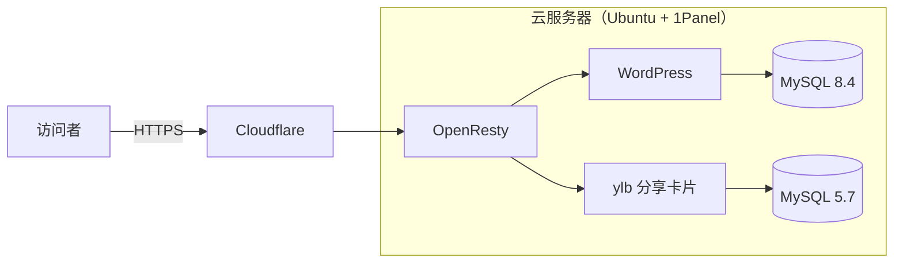

# 加中非遗文化传承协会 · 网站存档

[English](README.md) | 中文

这是我为**加中非遗文化传承协会**搭建和运营的官方网站，现在以中英双语静态网站的形式保存了下来。

**在线演示：** https://otyswkydo.github.io/yunlian-legacy-demo/ （[英文版](https://otyswkydo.github.io/yunlian-legacy-demo/en/)）

- 2025 年 8 月至 2026 年 8 月，作为自建的 WordPress 网站正式上线运行
- 服务器到期后，从一份 7.5 GB 的服务器快照里把网站完整恢复出来
- 现在免费托管在 GitHub Pages 上：中英文共 258 个页面，检查了 24,408 个站内链接，0 个失效

## 项目背景

协会在多伦多举办课程、演出和社区活动，推广面塑、花馍、京剧、八段锦等中华传统技艺和艺术。我觉得这件事对文化多样性很有意义，也能让更多人了解中华文化。

在这之前，我自己搭过 NAS，也做过几个小网站。我很想完整地运营一次真正的网站：有域名、有 HTTPS、有数据库、有备份，还有真实的访问者。于是我主动提出帮协会做官网。

我希望往计算机工程（Computer Engineering）方向发展。这个项目让我发现，我最喜欢的是把脑子里"理想中的样子"一步步变成真正能用的东西。比如我想让一个没有服务器的静态网页也能像商店一样加入购物车、改数量、算税，就得先拆解它需要哪些部分，试着做出来，再一点点修到每种边界情况都对。每解决一个问题，我都会弄懂一件以前不知道的事：数据库是怎么保存设置的，浏览器是怎么响应一次点击的，GitHub 文件夹旁边那句话是从哪来的。然后我会把它记成一条经验。"设想 → 动手 → 遇到问题 → 弄懂原因 → 总结"，这个循环正是我想在计算机工程里继续做下去的事。

网站上有 74 个商品和课程、15 篇活动文章、9 个页面、111 张图片。

## 第一阶段：上线运行（2025.8 – 2026.8）

我想让协会真正能放心使用，所以重点放在稳定和安全上。

- 租了一台云服务器，系统是 Ubuntu，用开源的 Linux 服务器管理面板 [1Panel](https://github.com/1Panel-dev/1Panel) 管理。
- 域名托管到 [Cloudflare](https://www.cloudflare.com/)：全程加密传输，同时隐藏服务器的真实 IP。
- WordPress 和 MySQL 分别运行在各自的 Docker 容器里，网站程序和数据互相隔离。
- 用 [OpenResty](https://openresty.org/)（基于 Nginx 的 Web 平台）做反向代理，把每个访问者送到对应的容器。
- 网站本身是 [WordPress](https://wordpress.org/) + [WooCommerce](https://woocommerce.com/)，主题用 [Blocksy](https://creativethemes.com/blocksy/)。

网站的主要受众习惯在微信里转发链接。可是微信只给通过认证的网站显示带标题、图片和摘要的卡片，我们的链接只显示成一串网址。后来我找到了 [私域引流宝（liKeYun_ylb）](https://github.com/likeyun/liKeYun_ylb)，一个免费开源（MIT 协议）的 PHP 工具，其中就有"微信分享卡片"功能。我把它作为独立的 PHP 服务部署在 WordPress 旁边，单独配了一个 MySQL 5.7 数据库。之后在微信里转发网站，就能显示带封面和简介的卡片了。

## 第二阶段：从快照恢复网站

2026 年 8 月服务器到期，我没有续费，只保存了完整的 1Panel 快照，大约 7.5 GB。目标也从"让网站继续运行"变成了"把网站存档"：不花钱、不用维护服务器，网站也能一直打开。

一开始我打算在 Mac 上用 VMware 开一个 Ubuntu 虚拟机，重装 1Panel、恢复备份，再用 [Simply Static](https://simplystatic.com/) 插件导出网页。但效果不好：在虚拟机里重建整台服务器，对 MacBook Air 来说太慢；免费版插件也导不全，有些部分要 Pro 版才行。

于是我改用 [OrbStack](https://orbstack.dev/) 在 macOS 上直接运行 Docker，并让 Claude 编写脚本来恢复网站。中间遇到的主要问题：

- **没有正常的数据库备份**，只有 MySQL 的原始文件，而用来读取它们的工具还会悄悄改坏一部分数据（见下文问题 1）。
- **快照备份的是整台服务器**，不只是这个网站。我从服务器的配置文件里理清了哪些文件夹、哪个数据库属于协会网站，并整理成一份清单文档。
- **很多小问题。** 脚本在 macOS 自带的老版本 Bash 上报错（见下文问题 2）；Docker 镜像总是下载超时；GitHub 上传时不再接受密码。每个都不算难，但都很花时间。我慢慢学会了先认真读报错信息，而不是乱试。

最后，一个 `restore-from-1panel.sh` 脚本就能从快照把网站恢复出来。私有仓库里只放这个项目的代码和文档，密码、密钥和数据库导出都不进 Git。

## 第三阶段：双语静态存档

静态网站不需要服务器和数据库，托管免费，也几乎没有可以被攻击的地方。问题是，直接导出会丢掉所有需要交互的功能，而我希望它用起来还像原来的网站。

导出脚本先用 wget 抓取本地网站，再处理抓取结果：补齐按需加载的文件，改写链接，去掉只能在服务器上运行的部分。在这个基础上，我又提出了下面这些功能，让 Claude 编写实现：

- **购物车。** 对一个存档网站来说，这其实不是必需的，毕竟已经没人在这里买东西了。加它主要是我想挑战一下：一个没有后端的静态网页，能不能做得像真正的商店一样。商品保存在访问者自己的浏览器里（`localStorage`）。可以加入商品，用 +/− 改数量，鼠标悬停在购物车图标上能看到预览，总价按安大略省 13% HST 自动计算。购物车、结账和注册页面都能作为演示使用，需要服务器的操作会弹出一句提示。
- **商品轮播**，有左右滑动动画，手机上可以用手指滑。
- **更整齐的结构。** 所有文章都收进 `blog/` 文件夹，旧网址依然能打开正确的页面，GitHub 上每个文件夹旁边都有一句说明。
- **完整的英文版。** 每个页面都有 EN / 中文 切换按钮，两种语言共用一个购物车。译文一共 471 条，约 17,700 个汉字，都放在一个对照表文件里。网站内容更新后，导出时会列出还没翻译的部分。
- **自适应页头。** 英文网站名比中文长很多，所以字号和菜单间距会跟着窗口宽度变化，任何宽度下都不会互相遮挡。

过程中遇到的几个难点（抓取停不下来、链接失效、购物车按钮失灵），详见下文"遇到的问题"一节。

## 我是怎么边学边做的

第一阶段搭建网站时，我没有系统学过服务器和网站运维，基本是边做边学：先在网上找现成的视频教程和经验帖，照着一步步搭；遇到报错，就把报错信息复制去搜索，看别人是怎么遇到、怎么解决的，再回来试。云服务器、1Panel、Docker、反向代理、Cloudflare 这些，都是这样一点点摸索出来的。

到了第二、三阶段，问题变得更具体，网上很难找到和我情况一模一样的答案，于是我换了一种方式：和 AI 助手 [Claude](https://claude.ai) 在一段很长的对话里一起完成。大部分脚本和代码由 Claude 编写和调试；我负责决定做什么，在自己的 Mac 上运行，在浏览器里测试，然后把发现的问题反馈回去。

大致过程是这样的：

1. 我先说明手里有什么（一份 1Panel 快照，已经没有服务器），想要什么（把网站恢复出来，用 GitHub 管理，隐私信息不能泄露）。几个关键选择由我决定：主仓库设为私有、用 OrbStack 运行 Docker。
2. 我在 Mac 上运行恢复脚本，把每一个报错都贴回来：路径写错、Bash 3.2 的 `unbound variable`、Docker Hub 超时、GitHub 拒绝密码登录，一个一个解决。
3. 免费插件导不全时，我问有没有别的办法，于是让 Claude 编写了现在的导出脚本。
4. 第一次导出后，我像普通访问者一样把网站逛了一遍，然后不断提修改和新功能：
   - 购物车和注册页面也要能演示；
   - 搜索弹窗的 ✕ 关不掉；
   - 想要鼠标悬停预览购物车、真正能加入购物车、数量改了自动算总价（去掉"更新购物车"按钮）、商品左右切换要有动画。
5. GitHub 上也要整齐：提交记录用我的用户名，文章都收进一个文件夹，每个文件夹旁边写上说明。
6. 再后来是完整的英文版，然后让页头能自适应缩放，以及修掉残留的演示链接。

这样做让我学到了很多。我不是直接复制修改结果，而是会追问每个问题为什么会出现，直到我自己能讲清楚为止。我还学会了把 bug 描述准确：点了哪里、本来应该怎样、实际发生了什么。后来发现，这其实是整个过程中最重要的一部分。

## 遇到的问题

### 1. 数据库看起来没问题，其实有数据被悄悄改坏了（第二阶段）

**遇到的问题：** 服务器备份里没有正常的数据库导出文件，只有 MySQL 的原始存储文件。我用一个叫 ibd2sql 的工具把它们还原成数据库。导入时没有报错，网站也能打开，我一开始以为成功了。

**检查后发现：** 逐条核对数据时，我发现有些文字变了。一种特殊的空格（用来让两个词不被拆到两行）变成了字母 `xa0`，WordPress 保存的一部分设置也完全读不出来。

原因是：这个工具按 Python 的规则写特殊字符，而 MySQL 读取时用的是另一套规则。同样是 `\xa0`，Python 的意思是"一个特殊空格"，MySQL 却只当成普通的 `x`、`a`、`0` 三个字母。

设置读不出来也是同一个原因。WordPress 保存很多设置时会在前面写上长度，比如 `s:5:"hello"`，意思是"一段 5 个字符的文字：hello"。如果其中一个字符变成了三个，标签上写的还是 5，内容却变长了，WordPress 就拒绝读取。

**改完以后：** 我让 Claude 把工具改成按 MySQL 的规则写，然后重新导出。改之前，有的设置读不出来，有的文字里多了 `xa0`；改之后，每张表的行数都和原始文件完全一致，**661** 条设置全部能正确读取。

**我学到的：** "没有报错"不等于"数据是对的"，结果要自己去核对。

### 2. 一个中文括号让整个脚本停了（第二阶段）

**遇到的问题：** 我在 Mac 上运行恢复脚本，它一开始就报错退出：`db?: unbound variable`，意思是"找不到叫 `db?` 的变量"。可我从来没定义过叫 `db?` 的东西。

**检查后发现：** 脚本里有一行写的是 `$db（`，也就是变量 `db` 后面紧跟着一个中文全角括号。运行脚本的程序叫 Bash，Mac 自带的是 2007 年的老版本。它会把中文括号的一部分也当成变量名，于是去找"`db` 加半个字符"这个根本不存在的变量。新版 Bash 不会这样，所以这个脚本在 Linux 上一直没出过问题。

**改完以后：** 我让 Claude 改成 `${db}`，用花括号明确标出变量名到哪里结束。改之前，脚本在每台 Mac 上都会停在第 68 行；改之后，可以从头到尾顺利跑完。

**我学到的：** 同样的代码放到不同的电脑上，结果可能不一样。要在真正会用到它的电脑上测试。

### 3. 导出一直停不下来（第三阶段）

**遇到的问题：** 网站只有 130 个左右的页面，导出应该很快。可是十几分钟过去了还在跑，文件夹里出现了一大堆名字像 `en?query-1-page=1&query-3-page=2&query-2-page=3&query-0-page=2.html` 的文件。

**检查后发现：** 首页上有 4 个商品轮播区。每个轮播区一次只显示几件商品，点左右箭头就翻到下一组，也就是"第 1 页、第 2 页、第 3 页……"。

问题在于，每翻一次页，首页的网址都会记下**4 个轮播区当前各在第几页**。导出程序把每一种不同的网址都当成了一个新页面：

- 轮播区 A 在第 2 页、B 在第 1 页、C 在第 3 页、D 在第 1 页，是一个网址；
- 只要 C 换成第 4 页、其他不变，就又是另一个网址。

假设每个轮播区有 5 页，组合就有 5 × 5 × 5 × 5 = 625 种。而且每个这样的页面上，又有指向其他组合的链接，导出程序就一直顺着点下去。

其实原来已经有一条规则会跳过这类网址，但它只认带 `/?` 的地址。新加的英文版首页地址是 `/en?`，正好漏了过去。所以这个问题是加了英文版之后才出现的。

**改完以后：** 我让 Claude 修改规则，把 `/en?` 也一起跳过。静态网站里的轮播本来就是用 JavaScript 翻页，根本用不到这些页面。改之前，导出停不下来，还存了一大堆几乎一样的首页；改之后，**1 分钟左右**就能完成，只保存真正需要的页面。

**我学到的：** 一件事花的时间比预想的长很多时，别只是干等，要去看它到底在做什么。这次，看一眼文件夹里的文件名就找到了答案。

### 4. 看着正常的链接，却跳到了错误的地方（第三阶段）

**遇到的问题：** 导出以后我把网站点了一遍，发现有些链接会跳到错误的页面。有一个小图标，打开后显示的竟然是整个首页。

**检查后发现：** 那个图标文件在服务器上根本不存在。WordPress 遇到这种情况不会直接说"找不到"，而是猜你想去哪里，结果猜的是首页。于是导出程序把首页的内容用图标的名字保存了下来。

另外还有一个问题：有些页面会把一小段 HTML 存在页面数据里，导出程序把它们误当成普通链接去"修正"，结果把这些数据弄坏了。

**改完以后：** 我让 Claude 做了三处修改：
- 导出时，不存在的文件一律直接回答"找不到"，并关掉 WordPress 的"猜网址"功能。
- 页面数据里的那段 HTML 换成导出程序不会去动的写法。
- 编写一个检查程序，自动打开每个页面、测试每个链接。

改之前，坏链接零零散散地藏在各处，只能靠手点去发现；改之后，检查程序测试了 **24,408** 个链接，结果是 **0** 个失效。

**我学到的：** 两万多个链接不可能靠手一个个点。需要反复检查的事情，就交给程序去做。

### 5. 购物车按钮只能用一次（第三阶段）

**遇到的问题：** 在购物车页面，第一次按 + 是好的，之后 + 和 − 都没反应了，只能手动输入数字。

**检查后发现：** 页面加载时，主题会给每个 +/− 按钮"接上线"，让它们知道被点击时该做什么。而原来的代码每改一次数量，就把整个购物车表格重新生成一遍。新按钮看起来一模一样，但没有接线，就像把墙上的开关换成一个一模一样的新开关，却忘了接电线。

**改完以后：** 我让 Claude 修改了代码：不再重新生成表格，只更新那几个数字：数量、单项小计和总价。点击也改成由整个购物车统一处理，这样就算以后出现新按钮也能响应。

改之前，+ 按一次就失灵；改之后，每次都能用。我还专门试了几种容易出错的情况：数量为 1 时按 −（保持为 1），快速连点 10 次 +（正好变成 11），把数字删掉再点别处（自动恢复成原来的数）。

**我学到的：** 如果一个东西第一次能用、之后就不行了，就问自己："第一次用完以后，有什么东西变了？"问题通常就在那里。

### 6. GitHub 上的文件夹说明（第三阶段）

**遇到的问题：** 我想让 GitHub 页面上每个文件夹旁边显示一句介绍，比如"文章：15 篇活动与非遗文化文章"。可是所有文件夹旁边显示的都是同一句话，也就是我那次整体上传时写的说明。

**检查后发现：** GitHub 并没有单独的"文件夹介绍"设置。文件夹旁边那句话，其实是最后一次修改这个文件夹时写的上传说明。如果所有东西一次性上传，每个文件夹就都会显示同一句话。

**改完以后：** 我让 Claude 把发布脚本改成按文件夹分别上传，每次写上这个文件夹自己的介绍，文章数、商品数也会自动统计填进去。改之前，每个文件夹的说明都一样；改之后，每个文件夹旁边都写着里面装的是什么。

**我学到的：** 想让一个东西呈现出某种效果，先要弄清楚它本来是怎么运作的。知道了那句话是从哪里来的，解决办法就很简单了。

## 技术体系

| 层次 | 用到的技术 | 阶段 | 我做的部分 |
|---|---|---|---|
| 服务器与网络 | Ubuntu、1Panel、Cloudflare、OpenResty、DNS、HTTPS | 一 | 自学并亲手搭建、配置 |
| 容器 | Docker、Docker Compose、OrbStack | 一、二 | 第一阶段用 1Panel 亲手部署；第二阶段让 Claude 编写配置，我在 Mac 上运行 |
| 网站应用 | WordPress、WooCommerce、Blocksy、ylb（PHP） | 一 | 亲手搭建网站、部署 ylb |
| 数据 | MySQL 8.4 / 5.7、ibd2sql、WP-CLI | 二 | 让 Claude 修复工具、编写恢复脚本；我运行并核对结果 |
| 自动化脚本 | Bash、Perl、Python、wget | 二、三 | 让 Claude 编写；我运行、反馈报错 |
| 前端 | HTML、CSS、JavaScript、localStorage | 三 | 提出功能需求并测试；让 Claude 编写 |
| 本地化 | 中英对照表、hreflang | 三 | 让 Claude 翻译初稿，由我校对 |
| 测试 | Playwright、链接检查程序 | 三 | 在浏览器里实际操作找 bug；让 Claude 编写自动测试 |
| 发布 | Git、GitHub CLI、GitHub Pages | 三 | 管理仓库、发布网站；让 Claude 编写发布脚本 |

## 如果重来一次

- 从第一天起就定期导出 `.sql` 备份，这样就不用绕一大圈从 `.ibd` 恢复数据。
- 服务器上的软件要定期更新和检查。"还能用"不等于"安全"。
- 早点想好网站的结局。如果一开始就知道网站以后要存档，有些插件我会选得不一样。

## 说明

网站内容和品牌归加中非遗文化传承协会所有。本仓库是非商业用途的存档和演示，商店和结账不会处理真实订单。

用到的项目：[WordPress](https://wordpress.org/)、[WooCommerce](https://woocommerce.com/)、[Blocksy](https://creativethemes.com/blocksy/)、[1Panel](https://github.com/1Panel-dev/1Panel)、[liKeYun_ylb](https://github.com/likeyun/liKeYun_ylb)、[OrbStack](https://orbstack.dev/)、[ibd2sql](https://github.com/ddcw/ibd2sql)、[WP-CLI](https://wp-cli.org/)、[GNU Wget](https://www.gnu.org/software/wget/)、[Playwright](https://playwright.dev/)、[GitHub Pages](https://pages.github.com/)。
